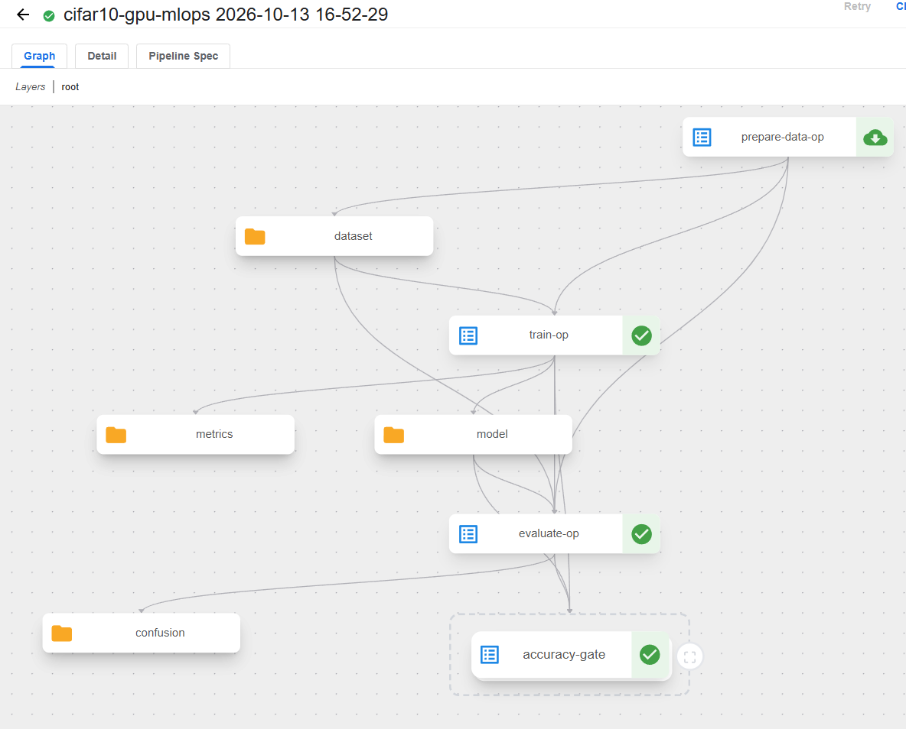
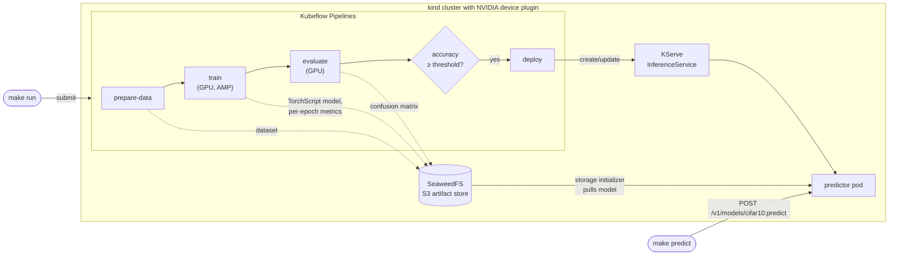

# Kubeflow GPU MLOps

[](https://github.com/vladimir-kazarin/kubeflow/actions/workflows/ci.yml)


[](LICENSE)

An end-to-end MLOps pipeline on Kubernetes. It fine-tunes ResNet-18 on CIFAR-10
on a local NVIDIA GPU, evaluates it on held-out data, and deploys it as a live
KServe HTTP endpoint **only if it beats an accuracy threshold**. A worse model
never replaces the one in production.

Everything runs on one machine (a kind cluster with GPU passthrough) with one
command per stage, and the ML code is unit-tested without a cluster or GPU.



## Results

| Metric | Value |
|---|---|
| Test accuracy (deployed model, all 10,000 CIFAR-10 test images, scored through the live endpoint) | **89.3%** |
| Training time, 20 epochs, mixed precision, RTX 4060 Laptop GPU | **6.4 min** |
| Training time, 5 epochs | 1.8 min |
| Accuracy gate | deploys when test accuracy ≥ 0.85 (configurable) |

A sample call to the endpoint (`make predict COUNT=16`):

```
actual      predicted   confidence
automobile  automobile  0.84 ✓
ship        ship        1.00 ✓
dog         dog         0.52 ✓
cat         dog         0.98 ✗
...
11/16 correct
```

## Architecture



One container image runs every pipeline step and the KServe predictor, so
training and serving use the same code and dependencies.

## Design decisions

- **Accuracy-gated deployment.** `evaluate` outputs `approved`, and `deploy`
  runs inside a `dsl.If` on it. `make run THRESHOLD=0.99` trains and evaluates
  but skips deploy, and the endpoint keeps serving the previous model.
- **No train/serve skew.** Resizing and ImageNet normalization live *inside*
  the exported TorchScript model. The predictor only decodes PNGs, so it can't
  preprocess differently from training.
- **Thin pipeline, testable core.** KFP components are short wrappers around
  `src/cifar_mlops/`, which holds all data, training, evaluation, serving, and
  deploy logic. That package has 88 unit tests and runs in CI with no cluster or GPU.
- **Idempotent deploy.** `deploy` creates *or* updates the InferenceService
  and waits until it reports `Ready`, so a pipeline success means the new model
  is actually serving.
- **Rollback for free.** Every run's model stays in the S3 artifact store.
  Rolling back means pointing the InferenceService's `STORAGE_URI` at an older
  run's model.
- **Defensive predictor.** Requests are validated: at most 64 instances,
  bounded base64 size, and a pixel limit that rejects PNG decompression bombs.
  Bad input gets a clear error instead of crashing or exhausting the pod.
- **Reproducible infra.** All component versions are pinned in
  `infra/versions.env`, and setup is a single `make setup`.

## Problems solved along the way

| Problem | Fix |
|---|---|
| The KServe storage initializer couldn't reach the model store | KFP 2.17 locks SeaweedFS behind a NetworkPolicy; added a policy that lets the `serving` namespace reach the S3 port only (`infra/serving.yaml`) |
| KFP 2.17 replaced MinIO with SeaweedFS, and KServe 0.21's cluster resources failed to apply | Setup now reads the object-store endpoint from KFP's own config and applies only the ClusterServingRuntimes (`infra/setup.sh`) |
| The NVIDIA device plugin crash-looped on a host running several clusters | Raised inotify limits in the host GPU runtime install script |
| `kubectl rollout restart` on the predictor had no effect | KServe owns that Deployment and reverts the change; delete the predictor pod instead |
| A model exactly at the threshold was rejected | Made the gate inclusive (`≥`) and covered it with a unit test |
| A small PNG can declare enormous dimensions | Check the pixel count before decoding |

## Quickstart

Requirements: Linux or WSL2 with an NVIDIA GPU, Docker, kind, kubectl, and Python 3.10+.

| Step | Command |
|------|---------|
| 1. GPU for Docker (once, needs sudo) | follow `infra/README.md` → Step 1 |
| 2. Cluster + Kubeflow Pipelines + KServe | `make setup` |
| 3. Python env + unit tests | `make venv test` |
| 4. Build image and check GPU in a pod | `make image gpu-check` |
| 5. Open the KFP UI (leave running) | `make ui` → http://localhost:8080 |
| 6. Train + evaluate + deploy | `make run` (try `EPOCHS=20`, `THRESHOLD=0.9`) |
| 7. Call the model | `make predict COUNT=16` |
| Start over | `make teardown` |

## Operating it

- **Inspect a run.** In the KFP UI, open Runs → your run. Click `metrics` on
  `train-op` for per-epoch loss and accuracy, and `confusion` on `evaluate-op`
  for the confusion matrix.
- **See what's serving.** Run
  `kubectl --context kind-kubeflow-lab -n serving get isvc cifar10 -o yaml | grep -A1 STORAGE_URI`.
  The URI contains the ID of the run that produced the model.
- **Roll out a rebuilt image.** After `make image`, run
  `kubectl --context kind-kubeflow-lab -n serving delete pod -l component=predictor`.
- **Roll back.** Run `kubectl --context kind-kubeflow-lab -n serving edit isvc cifar10`
  and set `STORAGE_URI` to an older run's model URI (shown in the KFP UI).

## Layout

| Path | What |
|------|------|
| `infra/` | cluster, GPU, KFP, and KServe setup scripts, pinned versions, troubleshooting |
| `src/cifar_mlops/` | data, model, training, evaluation, predictor, and deploy logic |
| `pipelines/` | KFP components and pipeline definition, plus the submit CLI |
| `scripts/predict.py` | client that sends CIFAR-10 test images to the endpoint |
| `tests/` | unit tests, including a pipeline compile check |
| `docs/superpowers/` | original design spec and implementation plan |

## Roadmap

- CI/CD that compiles and submits the pipeline on push (self-hosted GPU runner)
- Katib hyperparameter tuning feeding the accuracy gate
- Kubeflow Model Registry for model lineage
- Request logging, Prometheus/Grafana dashboards, and drift monitoring

## License

[MIT](LICENSE)
